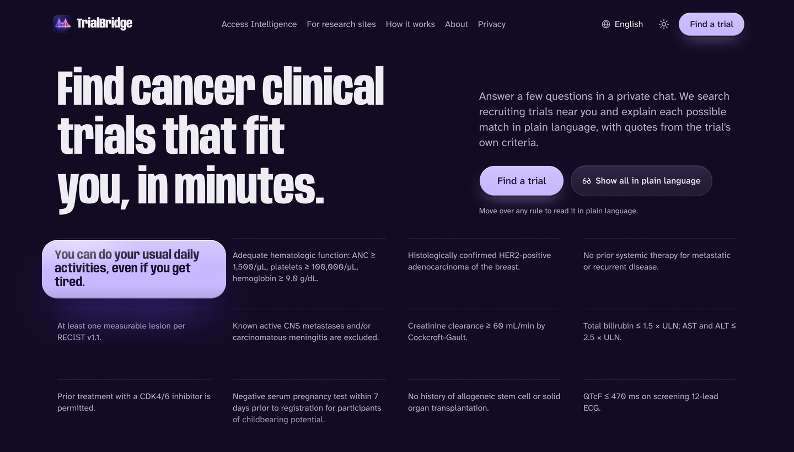
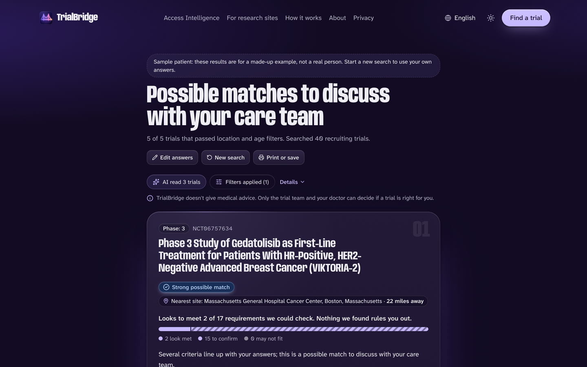
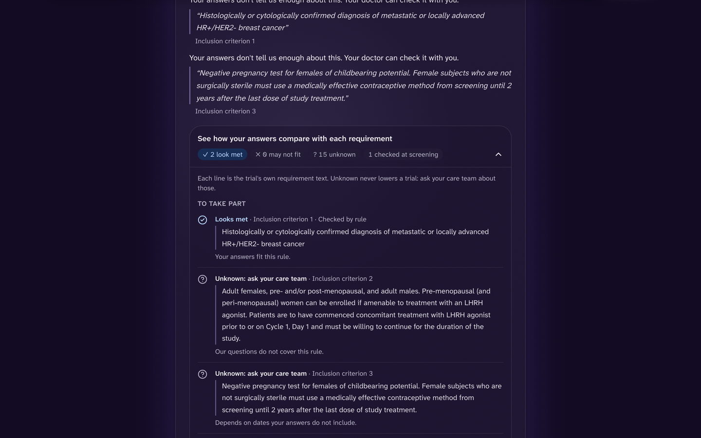
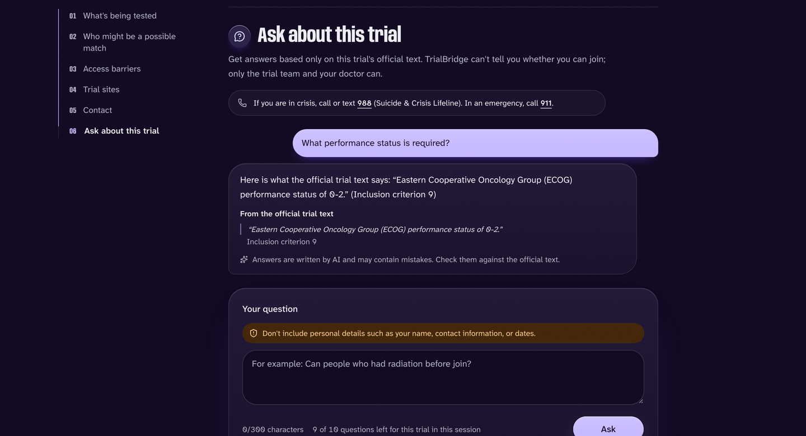
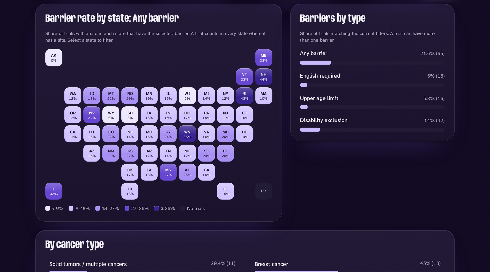
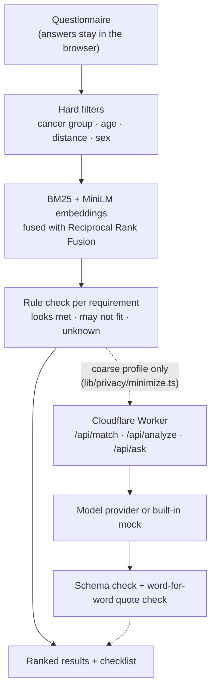

<p align="center">
  
</p>

<h1 align="center">TrialBridge</h1>

<p align="center">
  <strong>Find cancer clinical trials that fit you, in minutes, in plain language, with your answers kept on your own device.</strong>
</p>

<p align="center">
  
  
  
  
  
</p>

<p align="center">
  <a href="#try-it-in-three-commands">Quick start</a> ·
  <a href="#what-it-does">What it does</a> ·
  <a href="#how-it-works">How it works</a> ·
  <a href="#privacy-and-safety">Privacy</a> ·
  <a href="#evaluation">Evaluation</a> ·
  <a href="guide/README.md">Full guide</a>
</p>

<p align="center">
  
</p>

## Why it exists

Each cancer trial lists about 20 eligibility rules, often more, written for doctors. Patients and their families usually search alone, right after a diagnosis, and people who live far from a major cancer center or who don't read English comfortably have it hardest.

TrialBridge is for them. You answer a few questions in a private chat, and it searches recruiting U.S. cancer trials near you, checks each rule against your answers, and explains every possible match in plain language, quoting the trial's own text.

> **TrialBridge gives no medical advice.** Every result is a *possible match to discuss with your care team*. Data comes from ClinicalTrials.gov; TrialBridge is not affiliated with it or with any trial sponsor.

Built by **Shreyansh Vatsa** for the Congressional App Challenge 2026.

## Try it in three commands

You need **Node.js 22 or newer**. No accounts, API keys or paid services.

```bash
cd TrialBridge
npm ci
npm run demo
```

This builds a dataset of 301 real trials, starts the site at **http://localhost:8790** and opens your browser. On the Find page, choose **"Use the sample patient"** to see results without answering any questions, or go straight to http://localhost:8790/find/?demo=1.

<details>
<summary><strong>More ways to run it</strong> (full app with live AI, ports, troubleshooting)</summary>

### Demo mode details

`npm run demo` downloads the embedding model once (23 MB), builds the committed seed of 301 real trials, builds the site, starts it, runs a PASS/FAIL self-check and opens your browser (on Linux without `xdg-open`, open the URL yourself). Ctrl+C stops it.

- With no key it uses the built-in mock AI provider. The questionnaire, private matching, the requirement checklist, Trial Q&A safety rules and Access Intelligence all work; the AI explanations under each trial are placeholders. That is expected on a fresh clone.
- `data/demo/recorded-ai.json` holds real AI answers recorded for the sample patient against the national dataset. To see them, run `npm run ingest` once (downloads all ~5,700 recruiting U.S. cancer trials, a few minutes), then `npm run demo` again. An answer replays only if its trial text is unchanged on ClinicalTrials.gov; other trials fall back to the mock provider.
- A different port: `npm run demo -- --port=8800`. Force a rebuild: `npm run demo -- --rebuild`.
- On macOS you can double-click `Start TrialBridge Demo.command`. If Gatekeeper blocks a downloaded `.command` file, run `npm run demo` in Terminal instead.

### Full app with a free Groq key

1. Create a free API key at https://console.groq.com/keys.
2. `cp .dev.vars.example .dev.vars`, then paste the key after `GROQ_API_KEY=`. `.dev.vars` is gitignored; never commit it or share it.
3. `npm run local` (on macOS you can double-click `Start TrialBridge.command`).

This downloads the national dataset (resumable, falls back to the seed), builds, and serves the site plus the Worker API at **http://localhost:8787** with live AI explanations and Trial Q&A. A provider is used only if its key is set and `dataTermsVerified` is true for it in `config/ai-providers.ts`. The free tier has rate and daily limits; if the AI step is unavailable, results still appear from search and rules and the page says so. The AI step loads Cloudflare's Turnstile script (an always-pass test key locally).

</details>

## What it does

<table>
  <tr>
    <td width="50%" valign="top">
      <h3>Possible matches, ranked and explained</h3>
      Each result shows the nearest site and distance; how many requirements look met, still need confirming, or may not fit; and a plain-language summary. Trials with a clear conflict are listed lower, never hidden.
    </td>
    <td width="50%" valign="top">
      
    </td>
  </tr>
  <tr>
    <td width="50%" valign="top">
      
    </td>
    <td width="50%" valign="top">
      <h3>Every rule, checked one by one</h3>
      A trial's criteria are split into numbered requirements. Each is marked <em>looks met</em>, <em>may not fit</em>, or <em>unknown: ask your care team</em>, beside the trial's own sentence. "Unknown" never lowers a trial.
    </td>
  </tr>
  <tr>
    <td width="50%" valign="top">
      <h3>Ask about any trial</h3>
      Answers come only from the trial's official text, with the exact quote and criterion number. Crisis messages show 988 and 911; questions about diagnosis, treatment or "can I join" get a clear, fixed reply before any model is called.
    </td>
    <td width="50%" valign="top">
      
    </td>
  </tr>
  <tr>
    <td width="50%" valign="top">
      
    </td>
    <td width="50%" valign="top">
      <h3>Access Intelligence</h3>
      Across every recruiting cancer trial in the data: which ones require English, cap age below 75, or exclude people with disabilities without a medical reason, by state, cancer type and site, with counts beside every percentage.
    </td>
  </tr>
</table>

<p align="center">
  
  
  
  
</p>
<p align="center"><em>Designed for phones first, and installable as an app.</em></p>

### All features

| Feature | What it does |
| --- | --- |
| **Guided questionnaire** | Four essentials, then questions chosen by how much they narrow the candidates. Every optional question can be skipped, and "not sure" never lowers a result. |
| **Private matching in the browser** | Hard filters (cancer group, age, distance, stated sex) in code, then BM25 keyword search plus MiniLM sentence embeddings in a Web Worker, fused with Reciprocal Rank Fusion. The full ZIP code and exact age never leave the device. |
| **Requirement checklist** | Criteria split into numbered requirements and checked one by one, each with the trial's own sentence. |
| **Explanations with verified quotes** | For the top trials, an optional AI step reads only the requirements the rules could not settle and must quote the trial text word for word; quotes that don't match are thrown out. |
| **Trial Q&A** | Deterministic safety rules first, then answers that cite the official text or say the answer isn't in it. |
| **Access Intelligence** | Barrier rates by state, cancer type and site for every recruiting cancer trial in the data. |
| **13 languages** | English, Spanish, Portuguese and Hindi complete; Haitian Creole and French nearly complete; seven more partial with per-string English fallback. Translations are machine-generated. Official trial text stays in English. |
| **Works on weak connections** | Static site plus a small Worker. Installable as a PWA; the app shell loads offline. Degrades gracefully when the AI step is unavailable. |

## How it works



<details>
<summary><strong>Detailed diagram and data pipeline</strong></summary>

```
                         BROWSER (Next.js static export)
   +---------------------------------------------------------------------+
   | Questionnaire  ->  hard filters  ->  BM25 + MiniLM embeddings (RRF)  |
   |      |                                      |                       |
   |      |                              rule resolver per requirement   |
   |      |                                      |                       |
   |   answers stay here            ranked results + checklist           |
   +----------------------------+----------------------------------------+
                                | coarse profile only (lib/privacy/minimize.ts)
                                v
            Cloudflare Worker (functions/): /api/match, /api/analyze, /api/ask
   +---------------------------------------------------------------------+
   | same-origin + 16 KB limit + Turnstile + D1 rate limits + budgets     |
   | provider failover + circuit breaker -> schema check -> quote check  |
   +----------------------------+----------------------------------------+
                                v
                 OpenAI-compatible provider, or the built-in mock

   OFFLINE PIPELINE: ClinicalTrials.gov API v2 -> validate -> cancer groups (MeSH)
     -> split criteria -> rule facts + barrier flags -> int8 embeddings
     -> versioned shards, access.json, ZIP tables, D1 copy
```

</details>

### Tech stack

**TypeScript** throughout · **Next.js 16** (static export) · **React 19** · **Tailwind CSS 4** · **zod** · **MiniSearch** · **Transformers.js** with ONNX Runtime Web · **Cloudflare Workers + D1** · **Vitest** · **Playwright**. Small Python scripts sample evaluation data.

## Privacy and safety

- **No medical advice and no eligibility verdicts**, enforced by wording rules and by tests.
- **Matching runs in your browser.** The full ZIP code, exact age and travel distance never leave the device. Only the first three ZIP digits are used, to load a regional lookup table from the site itself; nothing about the ZIP goes to the API.
- **Only a coarse profile can reach a model provider**, through `lib/privacy/minimize.ts`: cancer type, age bracket, coarse disease, treatment and health-history categories, biomarkers and language. A network test checks that no raw questionnaire field appears in any request. Free text is sent only in Trial Q&A, with personal details scrubbed.
- **Safety rules run before any model call** for crisis, diagnosis, treatment-advice and eligibility questions.
- **Every quote is verified** against the trial text; anything that can't be verified becomes "not in the text."
- **Hardened server:** strict CSP with no inline scripts, HSTS, same-origin checks, Turnstile, rate limits, daily budgets, a build-time secret scan and self-hosted model files. See [`SECURITY.md`](SECURITY.md).

## Evaluation

Full results with confidence intervals: [`eval/RESULTS.md`](eval/RESULTS.md). Nothing here is a clinical-accuracy claim.

| What was measured | Result |
| --- | --- |
| **TREC Clinical Trials**, held-out cancer topics with human judgments: full pipeline vs search alone | nDCG@10 **+0.069** [0.015, 0.120]; excluded trials in the top tier of the top 10 fell from **40.0% to 22.9%** |
| **Vignette benchmark**, held-out test split: share of the top 10 that the labels say rule the patient out | **45.5% → 38.6%**, paired −0.069 [−0.104, −0.035] |
| **Vignette benchmark**, 164 synthetic patients, 5,389 labelled pairs (second-pass kappa 0.841) | Beats BM25, embeddings alone and the ClinicalTrials.gov search on both splits |
| **Hard filters** vs an independent check on raw registry fields | **0 violations** in 800 top-20 results |
| **Criteria splitter** vs a public gold standard | **95.6%** of trials split into exactly the right number of items; boundary F1 **0.986** |
| **Automated tests** | **1,332** unit tests, **86** end-to-end and accessibility tests |


## Repository layout

| Path | What is there |
| --- | --- |
| `app/` | Next.js routes (static export) |
| `components/` | UI: questionnaire, results, trial pages, Access Intelligence |
| `lib/` | Matching, rule resolver, privacy minimizer, safety rules, data loading, ingestion logic |
| `config/` | Cancer groups, biomarkers, criteria rules, the questionnaire catalog, AI provider list |
| `functions/` | Cloudflare Worker API (`/api/match`, `/api/analyze`, `/api/ask`) and the D1 schema |
| `prompts/` | Versioned model prompts |
| `scripts/` | Ingestion, evaluation, local run and build tooling |
| `data/` | Committed seed trials, ZIP centroids, data lock, recorded demo answers |
| `eval/` | Evaluation reports, gold labels and judgments |
| `tests/` | Unit (Vitest) and end-to-end / accessibility (Playwright) suites |
| `i18n/`, `public/i18n/` | Translation glossaries and state, and the shipped interface strings |
| `docs/` | Maintainer notes (`docs/dev/`) and README screenshots |
| `guide/` | The master guide |

**Docs:** the [master guide](guide/README.md) explains where everything is and how it runs · [`eval/RESULTS.md`](eval/RESULTS.md) has the evaluation · [`SECURITY.md`](SECURITY.md) covers the security and privacy model · [`docs/dev/`](docs/dev/README.md) has the maintainer notes.

<details>
<summary><strong>Development commands</strong></summary>

| Task | Command |
| --- | --- |
| UI only, hot reload (no API) | `npm run dev` |
| Full local build and preview (site + API + local D1) | `npm run build` then `npm run preview` |
| Lint, types, unit tests with coverage | `npm run lint`, `npm run typecheck`, `npm test` |
| End-to-end and accessibility tests (after a build; first time `npx playwright install chromium`) | `npm run test:e2e` |
| Everything CI runs | `npm run ci` |
| Seed data, national data | `npm run ingest:seed`, `npm run ingest` |
| Regression report (mock AI, no key; the national section needs `npm run ingest` first) | `npm run eval` |
| TREC matching eval (needs the TREC topics and qrels in `data/cache/trec/`, see `eval/trec/`; `--no-llm` skips the model arm) | `npm run eval:matching` |
| Vignette benchmark scores (committed data only; no download or key) | `npm run eval:vignettes` |
| Criterion-splitter check against TrialGPT (committed sample; no download or key) | `npm run eval:split` |
| Regenerate the translation manifest after English changes | `npm run i18n:manifest` |

What each eval file is and what produces it: [`eval/README.md`](eval/README.md).

</details>

<details>
<summary><strong>Open-source libraries and data sources</strong></summary>

| Library | Purpose | License |
| --- | --- | --- |
| Next.js, React, React DOM | Framework and UI rendering | MIT |
| MiniSearch | BM25 keyword index in the browser | MIT |
| `@huggingface/transformers` (Transformers.js) | Runs the embedding model in a Web Worker | Apache-2.0 |
| ONNX Runtime Web | WebAssembly inference, self-hosted | MIT |
| `Xenova/all-MiniLM-L6-v2` weights | Sentence embeddings, pinned revision, hash-verified | Apache-2.0 |
| zod | Validation of every input, output and data file | MIT |
| Tailwind CSS, tw-animate-css | Styling | MIT |
| shadcn (Base UI) | Button primitive and CSS variables | MIT |
| lucide-react | Icons | ISC |
| Lenis | Smooth scrolling on the landing page | MIT |
| clsx, tailwind-merge | Class-name helpers | MIT |
| class-variance-authority | Variant class-name helper | Apache-2.0 |
| Anybody, Atkinson Hyperlegible Next, Noto Sans | Fonts, self-hosted | SIL OFL 1.1 |
| Vitest, Playwright, `@axe-core/playwright` | Unit, end-to-end and accessibility tests | MIT, Apache-2.0, MPL-2.0 |
| ESLint, tsx, fflate | Tooling | MIT |
| TypeScript | Type checking | Apache-2.0 |
| Wrangler | Cloudflare Workers tooling and local preview | MIT or Apache-2.0 |

Everything else in the repository was written for this project. Trial data is from ClinicalTrials.gov (see its terms of use); ZIP centroids are from the U.S. Census gazetteer; TREC Clinical Trials topics and judgments are used for evaluation only (`eval/trec/TERMS.md`).

</details>

## License

Copyright (c) 2026 Shreyansh Vatsa. All rights reserved. The code is public for viewing and evaluation only; see [`LICENSE`](LICENSE). Open-source libraries keep their own licenses (listed above). Trial data is from ClinicalTrials.gov; check its terms of use.
